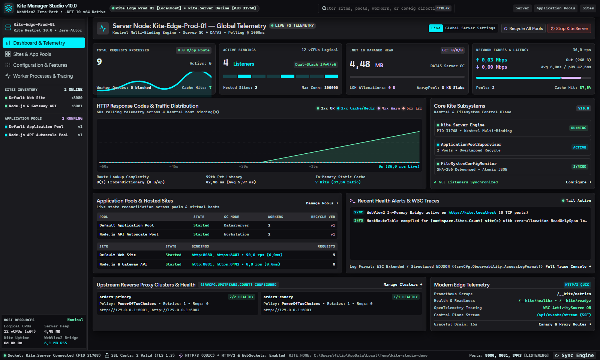
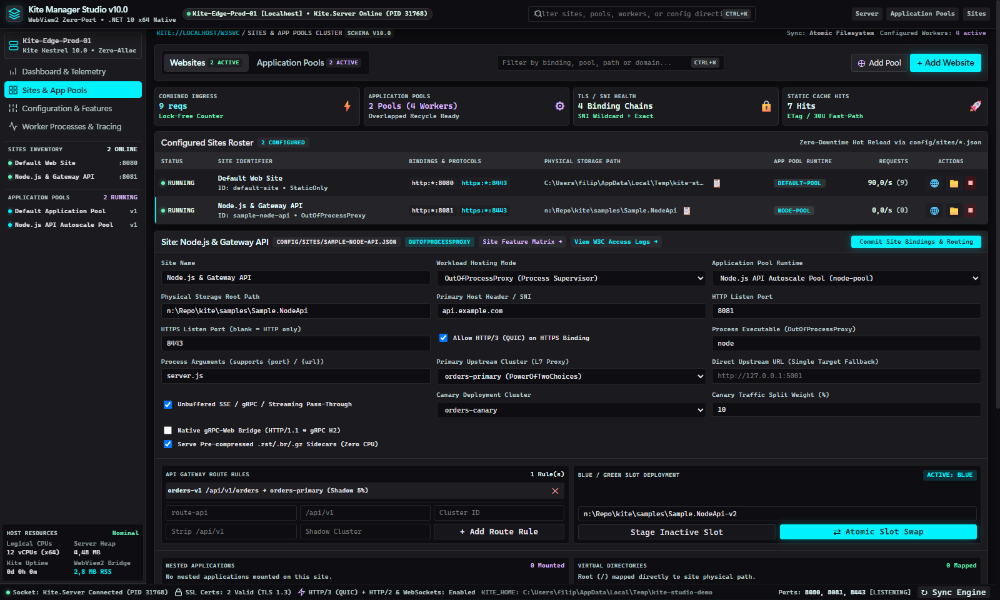
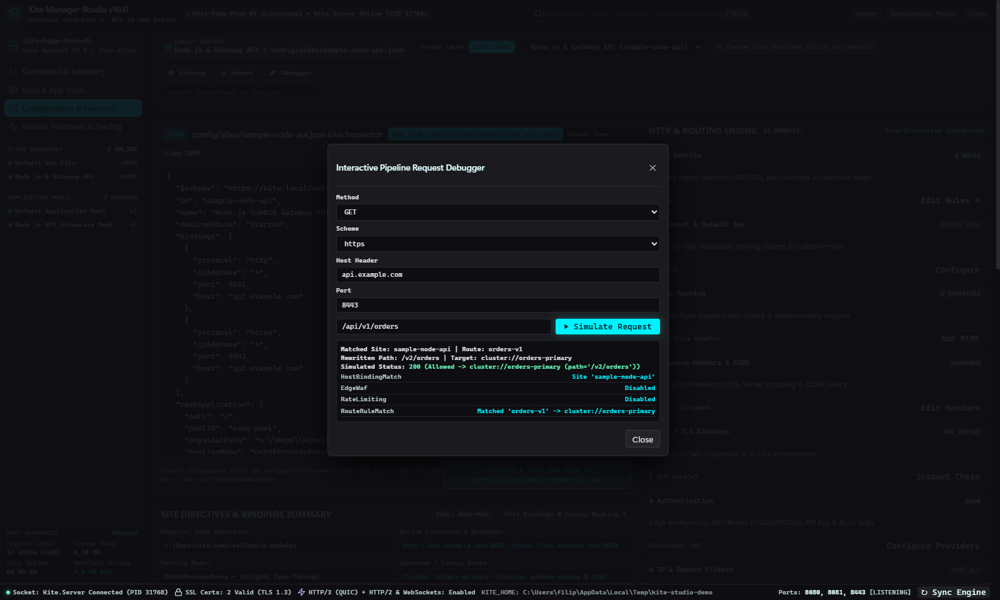
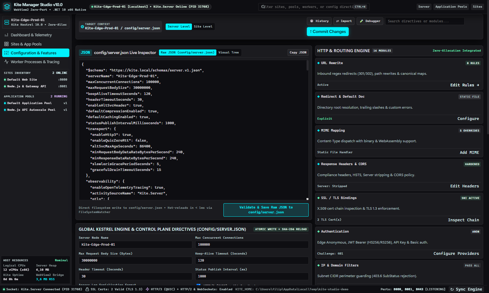
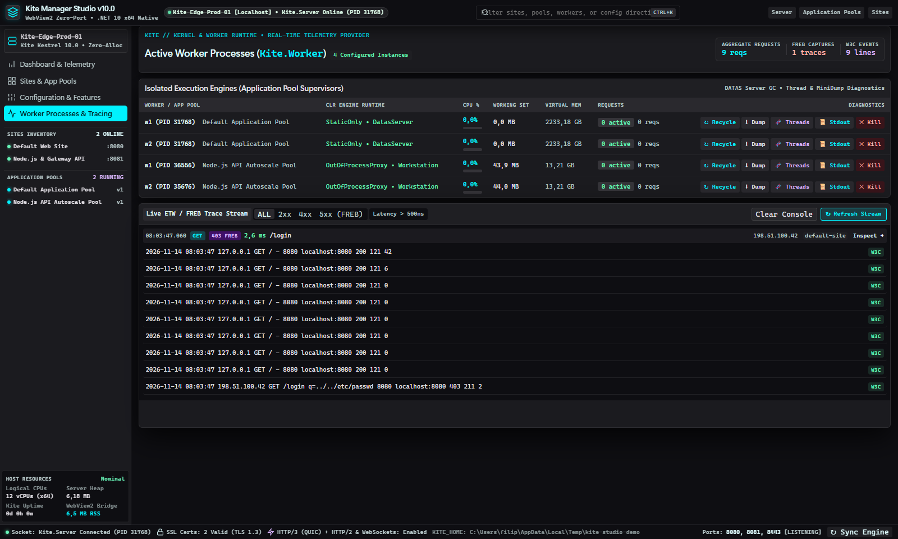

# Kite Edge Server & Polyglot Application Host

**Kite** is a zero-dependency-bloat, `.NET 10`-native HTTP/1.1, HTTP/2, HTTP/3 (QUIC), TLS/ACME, L4 SNI proxy, API gateway, and polyglot process manager paired with an offline-first **Obsidian Telemetry Desktop Studio** (`Kite.Desktop.WinForms` + WebView2) and a cross-platform CLI (`kite`).

Because Kite unifies static file serving, reverse proxying, polyglot process supervision (Python, Node.js, Go, .NET), manual/ACME/On-Demand TLS, and multi-node Redis state in one engine, this guide is structured in **cascading layers of complexity**—and **intentionally repeats critical rules (`KITE_HOME`, config layout, hot-reload, `{port}` injection, and debugging commands)** at every layer so you never get stuck guessing why something didn't match or reload.

---

## Table of Contents

0. [Installation (Windows, macOS, Linux)](#0-installation-windows-macos-linux)
1. [The 5 Things You Will Need Everywhere (Read Once, Remember Always)](#1-the-5-things-you-will-need-everywhere)
2. [Level 1 — Polyglot Quick Start (Static, .NET, Node.js, Python)](#2-level-1--polyglot-quick-start)
3. [Level 2 — Serving Static Files, Caching, Compression & SPAs](#3-level-2--serving-static-files)
4. [Level 3 — Serving Dynamic Apps (Out-of-Process, .NET IPC, Reverse Proxy & API Gateway)](#4-level-3--serving-dynamic-apps)
5. [Level 4 — Configuring Certificates (Manual PFX, SNI, HSTS & mTLS)](#5-level-4--configuring-certificates)
6. [Level 5 — Configuring Auto TLS (ACME v2 HTTP-01 / TLS-ALPN-01 / DNS-01 & On-Demand TLS)](#6-level-5--configuring-auto-tls)
7. [Level 6 — Configuring Distributed State & Production Operations (Redis, WAF, OTLP, Importers)](#7-level-6--configuring-distributed-state--production-operations)
8. [CLI & Troubleshooting Cheat Sheet](#8-cli--troubleshooting-cheat-sheet)
9. [Performance & TechEmpower Benchmark Results](#9-performance--techempower-benchmark-results)

---

## 0. Installation (Windows, macOS, Linux)

Self-contained release bundles include both the **`kite` CLI** and **`kite-server` (`Kite.Server`)** with no `.NET 10` runtime prerequisite.

### Windows
- **Winget** ([manifest](./packaging/winget/manifests/k/KiteConstructionTeam/Kite/1.0.0)):
  ```powershell
  winget install KiteConstructionTeam.Kite
  ```
- **Chocolatey** ([package](./packaging/chocolatey/kite.nuspec)):
  ```powershell
  choco install kite
  ```

### macOS
- **Homebrew** ([formula](./packaging/homebrew/Formula/kite.rb)):
  ```bash
  brew install kite-construction-team/tap/kite
  ```
  Run Kite as a background macOS `launchd` service (`KITE_HOME=$(brew --prefix)/var/kite`):
  ```bash
  brew services start kite
  ```

### Linux
- **Bash install script** ([`scripts/install.sh`](./scripts/install.sh)):
  ```bash
  # User-local install (~/.local/share/kite/app + ~/.local/bin)
  curl -fsSL https://raw.githubusercontent.com/kite-construction-team/kite/main/scripts/install.sh | bash

  # System-wide install (/opt/kite + /usr/local/bin + systemd service + :80/:443 capability)
  curl -fsSL https://raw.githubusercontent.com/kite-construction-team/kite/main/scripts/install.sh | sudo bash -s -- --with-systemd --grant-low-ports
  ```

### Post-Install Verification
```bash
kite --version
kite paths
kite init && kite run
```

---

## 1. The 5 Things You Will Need Everywhere

1. **Where your config lives (`KITE_HOME`)**:
   Kite resolves its data directory (`KITE_HOME`) in this exact priority order:
   1. `--home <path>` CLI argument
   2. `KITE_HOME` environment variable
   3. Nearest `.kite/` directory walking upward from the current working directory (initialize one with `kite init`)
   4. `<repo-root>/kite-data` (automatically used when running inside a directory tree containing `Kite.slnx`)
   5. OS & privilege-aware default:
      - **Windows**: `%LOCALAPPDATA%\Kite\kite-data` (or `%ProgramData%\Kite\kite-data` when running as a Windows Service)
      - **macOS**: `~/Library/Application Support/Kite/kite-data` (or `/var/lib/kite` when running as root; Homebrew service uses `$(brew --prefix)/var/kite`)
      - **Linux**: `$XDG_DATA_HOME/kite/kite-data` (`~/.local/share/kite/kite-data`) for users, or `/var/lib/kite` when running as root / `systemd`

   Inside `KITE_HOME`, every resource has a fixed location:
   ```text
   <KITE_HOME>/
   ├── config/
   │   ├── server.json            # Global Kestrel, HTTP/3, Upstreams, TCP Streams, Redis, Server-level Features
   │   ├── pools/<poolId>.json    # Process runtime, WorkerCount, Autoscale Min/Max, Env Vars, Recycling, Sidecars
   │   ├── sites/<siteId>.json    # Bindings (ports/hosts/PFX), Apps, VirtualDirs, Site-level Features & Routes
   │   ├── certs/                 # ACME account (acme-account.json) & auto-provisioned <domain>.pfx certificates
   │   └── .history/              # Automatic timestamped snapshots before every save/import (for rollback)
   ├── plugins/                   # Drop-in C# IKiteEdgeMiddleware assemblies
   ├── state/                     # Runtime *.status.json telemetry snapshots published by Kite.Server
   └── logs/                      # W3C/NDJSON access logs, FREB traces (logs/freb), and crash dumps
   ```

2. **Sites vs. Pools (Never mix these up)**:
   - **Site (`config/sites/<id>.json`)**: Owns *network & HTTP concerns* — `bindings` (`protocol`, `ipAddress`, `port`, `host`, `tls`), `rootApplication.physicalPath`, `hostingMode`, `executable`/`arguments`, `routes`, WAF, auth, rate limits, and TLS policies.
   - **Application Pool (`config/pools/<id>.json`)**: Owns *OS process & scaling concerns* — `workerCount`, `minWorkers`/`maxWorkers`, `useUnixDomainSocket`, `startMode` (`AlwaysRunning`/`OnDemand`), `gcMode` (`DatasServer`/`Server`/`Workstation`), `environmentVariables`, `recycling`, and `sidecars`.
   - Every site (`rootApplication.poolId`) and nested application points to a Pool ID.

3. **Locked Config Schema (`"configVersion": "1.0"`), CamelCase JSON & Instant Hot-Reload**:
   - Every `config/server.json`, `config/pools/*.json`, and `config/sites/*.json` file is locked to `"configVersion": "1.0"` (enforced by generated v1 JSON Schemas, `KiteManagementService`, `FileSystemConfigMonitor`, and `kite validate`).
   - All JSON uses **camelCase** keys and **string enums** (e.g., `"Started"`, `"OutOfProcessProxy"`, `"Http01"`). Trailing commas and `//` comments are tolerated on read.
   - Every save writes atomically (`.tmp` + rename) and triggers a `FileSystemWatcher` + SHA-256 hash check, hot-reloading Kite's pipeline, pools, and listeners—while automatically saving a restore point in `config/.history/`.

4. **Site Feature Inheritance (`features.inheritServerDefaults`)**:
   - By default, a Site has `"inheritServerDefaults": true`, meaning it inherits everything in `server.json` → `features` (URL Rewrite, Auth, WAF, ACME, Rate Limits, Headers, etc.).
   - If you add custom Site rules or overrides in `config/sites/<id>.json`, make sure `"inheritServerDefaults": false` inside that site's `"features"` block (the Desktop UI does this for you automatically when saving site-level rules).

5. **Your Trial-and-Error Lifesavers (Run these before guessing)**:
   ```bash
   dotnet run --project src/Kite.Cli -- validate --home ./kite-data
   dotnet run --project src/Kite.Cli -- route-test https://api.example.com/v1/users --home ./kite-data
   dotnet run --project src/Kite.Cli -- history --home ./kite-data
   dotnet run --project src/Kite.Cli -- rollback <snapshotId> --home ./kite-data
   dotnet run --project src/Kite.Cli -- logs --site default-site --tail --home ./kite-data
   ```
   Or in **Kite Desktop Studio**, use **🧪 Debugger**, **🕒 History**, **View W3C Access Logs**, **📋 FREB Inspector**, and **📜 Stdout** on any worker row.

---

## 2. Level 1 — Polyglot Quick Start

### Option A: Launch the Windows Desktop Studio (GUI + Engine)
```bash
dotnet build Kite.slnx
dotnet run --project src/Kite.Desktop.WinForms
```
- Uses zero-port WebView2 (`http://kite.localhost`) backed directly by `KiteInMemoryHost`.
- On first boot, seeds `kite-data/config/server.json`, `config/pools/default-pool.json`, and `config/sites/default-site.json` listening on standard HTTP `:80` and HTTPS `:443` (with a dev certificate). If `:80` or `:443` is busy (e.g., IIS/nginx) or blocked by OS privileges, Kite automatically falls back to `:8080` / `:8443` and prints the active fallback mapping.
- Manage Sites, Pools, Raw JSON / 17 Feature Modules, Live Worker Stdout, Config History, Legacy Config Imports, and the Pipeline Debugger visually.



### Option B: Launch Headless Server (`kite run`) (Windows / Linux / Docker)
```bash
dotnet run --project src/Kite.Cli -- run --home ./kite-data
```
To expose the Obsidian Web Studio over loopback HTTP or Unix Domain Socket in headless/Linux environments:
```bash
dotnet run --project src/Kite.Cli -- run --home ./kite-data --admin-port 9090 --admin-token "my-secret-token"
```
Then open `http://127.0.0.1:9090` (with `Authorization: Bearer my-secret-token`).

### Included Polyglot Samples
All four ready-to-run workloads live under [`samples/`](./samples):

| Sample Directory | Runtime | `hostingMode` | Key Highlight |
| :--- | :--- | :--- | :--- |
| [`samples/Sample.StaticSite`](./samples/Sample.StaticSite) | Static HTML | `StaticOnly` | Zero-allocation cached static site |
| [`samples/Sample.DotNetApi`](./samples/Sample.DotNetApi) | .NET 10 / ASP.NET Core | `KiteWorkerIpc` or `OutOfProcessProxy` | Native Named Pipe IPC or Kestrel port |
| [`samples/Sample.NodeApi`](./samples/Sample.NodeApi) | Node.js (>= 18) | `OutOfProcessProxy` | Zero-dependency `node:http` API + SSE stream + `/healthz` |
| [`samples/Sample.PythonApi`](./samples/Sample.PythonApi) | Python 3 (>= 3.8) | `OutOfProcessProxy` | Zero-dependency `ThreadingHTTPServer` + SSE stream + ready-to-copy [`kite.site.json`](./samples/Sample.PythonApi/kite.site.json) & [`kite.pool.json`](./samples/Sample.PythonApi/kite.pool.json) |

### Try a Polyglot App in 30 Seconds (Node.js & Python)
Copy the ready-made configs from the sample folders straight into `<KITE_HOME>/config/` (update `physicalPath` to your repo path):

- **Node.js** (`samples/Sample.NodeApi`):
  - Copy [`samples/Sample.NodeApi/kite.pool.json`](./samples/Sample.NodeApi/kite.pool.json) → `kite-data/config/pools/node-pool.json`
  - Copy [`samples/Sample.NodeApi/kite.site.json`](./samples/Sample.NodeApi/kite.site.json) → `kite-data/config/sites/sample-node-api.json`
  - Hit `http://localhost:8081/`, `/api/telemetry`, `/sse/events` (SSE streaming!), or `POST /api/echo`.

- **Python** (`samples/Sample.PythonApi`):
  - Copy [`samples/Sample.PythonApi/kite.pool.json`](./samples/Sample.PythonApi/kite.pool.json) → `kite-data/config/pools/python-pool.json`
  - Copy [`samples/Sample.PythonApi/kite.site.json`](./samples/Sample.PythonApi/kite.site.json) → `kite-data/config/sites/sample-python-api.json`
  - Hit `http://localhost:8082/`, `/api/info`, `/sse/stream`, or `POST /api/echo`.

> **Key Info Recap — The `OutOfProcessProxy` Contract**:
> Whenever Kite launches an external process (`node`, `python`, `uvicorn`, `go`, `dotnet`), Kite **automatically allocates a free loopback port** (or Unix socket path if `useUnixDomainSocket: true`), passes `--urls http://127.0.0.1:<port>` by default (or replaces `{port}`, `{url}`, `{socket}` in your `arguments`), **and** injects `PORT`, `ASPNETCORE_URLS`, and `KITE_UPSTREAM_URL` into the child process environment!
> On Windows, if `python` points to the Microsoft Store stub (`WindowsApps\python.exe`), set `"executable"` to the real interpreter path (e.g. `C:\Python39\python.exe` or `.venv\Scripts\python.exe`). Always set `"PYTHONUNBUFFERED": "1"` in the pool's `environmentVariables` so logs flush immediately into Kite's Stdout buffer.

---

## 3. Level 2 — Serving Static Files

`StaticOnly` mode serves files from disk with zero-allocation routing (`VirtualPathTree`), RFC 9110 conditional requests (`ETag` / `Last-Modified` → `304 Not Modified`) & Byte-Range (`206 Partial Content` / `416`), pre-compressed sidecars (`.zst`, `.br`, `.gz`), RFC 9111 Output Caching backed by `SegmentedBufferStream` (zero LOH allocations), and HTML5 SPA fallback.

### Minimal Static Site (`config/sites/static-docs.json`)
```json
{
  "$schema": "../schemas/site.v1.schema.json",
  "configVersion": "1.0",
  "id": "static-docs",
  "name": "Static & SPA Docs",
  "desiredState": "Started",
  "bindings": [
    {
      "protocol": "http",
      "ipAddress": "*",
      "port": 80,
      "host": "docs.local"
    }
  ],
  "rootApplication": {
    "path": "/",
    "poolId": "default-pool",
    "physicalPath": "N:/Repo/kite/samples/Sample.StaticSite",
    "hostingMode": "StaticOnly",
    "servePrecompressedSidecars": true,
    "virtualDirectories": [
      {
        "virtualPath": "/media",
        "physicalPath": "D:/assets/media"
      }
    ]
  },
  "features": {
    "inheritServerDefaults": false,
    "defaultDocuments": ["index.html", "default.html"],
    "directoryBrowsing": false,
    "compression": {
      "enabled": true,
      "minSizeBytes": 128,
      "encodings": ["zstd", "br", "gzip", "deflate"],
      "brotliLevel": 5,
      "zstdLevel": 3,
      "gzipLevel": 7
    },
    "caching": {
      "enabled": true,
      "defaultMaxAgeSeconds": 3600,
      "maxCacheBodyBytes": 4194304,
      "maxCacheSizeMegabytes": 500
    },
    "mimeMappings": {
      "fallbackContentType": "application/octet-stream",
      "customMappings": {
        ".wasm": "application/wasm",
        ".svg": "image/svg+xml",
        ".json": "application/json; charset=utf-8"
      }
    },
    "spaFallback": {
      "enabled": true,
      "fallbackDocument": "/index.html",
      "excludePrefixes": ["/api", "/assets", "/.well-known", "/__kite"]
    },
    "redirectsAndErrors": {
      "enforceTrailingSlash": false,
      "errorMode": "CustomPages",
      "customErrorPages": {
        "404": "/404.html"
      }
    },
    "earlyHintsLinks": [
      "</assets/app.css>; rel=preload; as=style",
      "</assets/app.js>; rel=preload; as=script"
    ]
  }
}
```

### Static Serving Tips & Common Pitfalls
- **Pre-compressed sidecars (`servePrecompressedSidecars: true`)**: If `app.js.zst`, `app.js.br`, or `app.js.gz` sits beside `app.js`, Kite negotiates `Accept-Encoding` (honoring `;q=0` rejection rules) and streams the pre-compressed artifact directly without burning CPU on live compression.
- **SPA Fallback vs. API 404s**: `spaFallback` only rewrites extensionless routes *outside* `excludePrefixes` when no physical file matches. Paths like `/api/missing` or `/assets/missing.css` still return `404`.
- **Caching & Flush Generation**: Output cache respects `Cache-Control: no-cache` / `no-store` and automatically invalidates unsafe methods (`POST`, `PUT`, `DELETE`). Bump `caching.flushGeneration` (or click **Purge Output Cache** in the Studio UI) to flush cached static responses immediately.
- **URL Rewrite**: Add `features.urlRewrite.rules` (`Redirect301`, `Redirect302`, `Rewrite`, `CustomResponse`) with PCRE-style regexes (`^/old/(.*)$` → `/new/{R:1}`). Kite automatically lets `/.well-known/acme-challenge/` pass before rewrite rules when `enableAcmeHttp01PassThrough` is `true`.

> **Key Info Recap**: Notice `"inheritServerDefaults": false` in `"features"` above! Whenever you customize static compression, SPA fallback, headers, or rewrite rules inside a specific `config/sites/<id>.json`, you must set `"inheritServerDefaults": false`; otherwise `server.json` → `features` silently wins. Run `kite route-test http://docs.local/dashboard` to verify whether SPA fallback or a rewrite matched.

---

## 4. Level 3 — Serving Dynamic Apps

Kite gives you **three dynamic workload models** (`hostingMode`), mixable across the root application and `nestedApplications` (e.g., SPA at `/` + Python ML service at `/ml` + .NET API at `/api`):

| `hostingMode` | Transport | Managed By Kite? | Best For |
| :--- | :--- | :--- | :--- |
| **`OutOfProcessProxy`** | HTTP/1.1 / h2c / `AF_UNIX` socket | Yes (`executable` + `arguments`) | Python (Flask/FastAPI/Uvicorn), Node.js, Go, Rust, or standalone Kestrel binaries |
| **`KiteWorkerIpc`** | Named Pipes + `Kite.Worker` runtime | Yes (managed .NET CLR host) | Zero-boilerplate `.NET 10` assemblies (`entryPoint`) with per-pool GC tuning |
| **`ExternalReverseProxy`** | Pooled HTTP / HTTP/2 / gRPC / SSE | No (external cluster/service) | Existing microservices, Kubernetes/Docker containers, canary clusters, API gateway routing |

### Mode A: Polyglot Managed Processes (`OutOfProcessProxy`) + Scale-to-Zero & Sidecars

**Pool (`config/pools/python-autoscale-pool.json`)**:
```json
{
  "$schema": "../schemas/pool.v1.schema.json",
  "configVersion": "1.0",
  "id": "python-autoscale-pool",
  "name": "Python FastAPI Autoscale Pool",
  "desiredState": "Started",
  "processModel": {
    "workerCount": 1,
    "minWorkers": 0,
    "maxWorkers": 6,
    "scaleUpConcurrencyThreshold": 15,
    "scaleDownIdleSeconds": 90,
    "useUnixDomainSocket": false,
    "idleTimeoutMinutes": 20,
    "startMode": "OnDemand",
    "environmentVariables": {
      "PYTHONUNBUFFERED": "1",
      "APP_ENV": "production"
    },
    "sidecars": [
      {
        "id": "redis-or-helper",
        "enabled": true,
        "executable": "node",
        "arguments": "telemetry-relay.js"
      }
    ]
  },
  "recycling": {
    "periodicRestartMinutes": 1440,
    "maxMemoryMegabytes": 1024,
    "maxRequests": 50000,
    "scheduledRestartUtcTime": "04:00",
    "disallowOverlappingRotation": false
  },
  "rapidFailProtection": {
    "enabled": true,
    "maxCrashes": 5,
    "intervalMinutes": 5
  }
}
```

**Site (`config/sites/fastapi-site.json`)**:
```json
{
  "$schema": "../schemas/site.v1.schema.json",
  "configVersion": "1.0",
  "id": "fastapi-site",
  "name": "FastAPI Service",
  "desiredState": "Started",
  "bindings": [
    { "protocol": "http", "ipAddress": "*", "port": 8082, "host": "api.local" }
  ],
  "rootApplication": {
    "path": "/",
    "poolId": "python-autoscale-pool",
    "physicalPath": "D:/apps/my-fastapi",
    "hostingMode": "OutOfProcessProxy",
    "executable": "D:/apps/my-fastapi/.venv/Scripts/python.exe",
    "arguments": "-m uvicorn main:app --host 127.0.0.1 --port {port}",
    "enableStreamingPassThrough": true,
    "enableGrpcWebBridge": false
  }
}
```

How Kite supervises external workers:
1. **Placeholders & Env Injection**: Use `{port}`, `{url}`, or `{socket}` inside `arguments`. Kite also sets `PORT`, `ASPNETCORE_URLS`, and `KITE_UPSTREAM_URL` (plus `KITE_UNIX_SOCKET` when `useUnixDomainSocket: true`).
2. **Scale-to-Zero (`minWorkers: 0`) & Autoscaling**: When idle, Kite spins down all workers after `scaleDownIdleSeconds` (or `idleTimeoutMinutes`). Incoming requests queue briefly while the cold-start worker boots and serves `200`, then scale out up to `maxWorkers` whenever concurrent in-flight requests cross `scaleUpConcurrencyThreshold`.
3. **Unix Domain Sockets (`useUnixDomainSocket: true`)**: Bypasses loopback TCP stack for local Linux/Windows `uvicorn --uds {socket}` or Node/Go UDS servers.
4. **Overlapped Recycling (`disallowOverlappingRotation: false`)**: Spawns the replacement generation first, drains in-flight requests on old workers, and swaps cleanly with zero dropped requests.
5. **Blue/Green Physical Path Swaps**: Set `activeSlot` / `stagingPhysicalPath`, or run:
   ```bash
   dotnet run --project src/Kite.Cli -- deploy --site fastapi-site --path D:/releases/v2 --swap --home ./kite-data
   ```
6. **Live Stdout/Stderr Diagnostics**: Kite captures a rolling ring buffer (`recentOutputLines`) of worker stdout/stderr. Open **Workers → 📜 Stdout** in Desktop Studio to see Python/Node tracebacks live without attaching a terminal.

### Mode B: Managed `.NET 10` Workers (`KiteWorkerIpc`)
Point `"hostingMode": "KiteWorkerIpc"` and `"entryPoint": "D:/apps/MyApp/bin/Release/net10.0/MyApp.dll"` (or use `Kite.Worker`) with pool settings:
- `"gcMode"`: `"DatasServer"` (Dynamic Adaptation To Application Sizes), `"Server"`, or `"Workstation"`
- `"recycling.maxMemoryMegabytes"`: injects `DOTNET_GCHeapHardLimit` (hex bytes) + `DOTNET_gcServer` + `DOTNET_GCDynamicAdaptationMode` directly into the worker CLR!

### Mode C: Reverse Proxy Clusters, Canary Splits & API Gateway (`ExternalReverseProxy` + `routes`)
Define backend pools once in **`config/server.json` → `upstreams`**, then attach them to Sites or declarative Gateway Route Rules:

```json
// Inside config/server.json
{
  "$schema": "./schemas/server.v1.schema.json",
  "configVersion": "1.0",
  "upstreams": [
    {
      "id": "orders-v1",
      "loadBalancingPolicy": "PowerOfTwoChoices",
      "requestTimeoutSeconds": 30,
      "retryCount": 1,
      "activeHealthCheck": {
        "enabled": true,
        "intervalSeconds": 10,
        "timeoutSeconds": 3,
        "path": "/healthz",
        "expectedStatusCode": 200
      },
      "passiveCircuitBreaker": {
        "enabled": true,
        "failureThreshold": 3,
        "ejectionSeconds": 30
      },
      "destinations": [
        { "id": "node-a", "address": "http://127.0.0.1:5001", "weight": 2 },
        { "id": "node-b", "address": "http://127.0.0.1:5002", "weight": 1 }
      ]
    },
    {
      "id": "orders-v2-canary",
      "destinations": [{ "id": "canary-1", "address": "http://127.0.0.1:5003", "weight": 1 }]
    }
  ]
}
```
Supported load balancing policies: `RoundRobin`, `LeastRequests`, `PowerOfTwoChoices`, `ConsistentHash` (paired with `stickyHeaderOrCookie`).

Add **Gateway Route Rules, Transforms, Shadowing, ForwardAuth & Fault Injection** inside `config/sites/<id>.json` → `features`:
```json
"features": {
  "inheritServerDefaults": false,
  "forwardAuth": {
    "enabled": true,
    "endpointUrl": "http://127.0.0.1:9001/verify",
    "timeoutMilliseconds": 1500,
    "copyRequestHeaders": ["Authorization", "Cookie"],
    "copyResponseHeaders": ["X-Auth-User", "X-Auth-Roles"],
    "failOpen": false
  },
  "routes": [
    {
      "id": "orders-api",
      "enabled": true,
      "pathPrefix": "/api/v1/orders",
      "methods": ["GET", "POST"],
      "matchHeaders": { "X-Region": "eu" },
      "targetClusterId": "orders-v1",
      "canaryClusterId": "orders-v2-canary",
      "canaryWeightPercent": 10,
      "shadowClusterId": "orders-v2-canary",
      "shadowPercent": 5,
      "transform": {
        "stripPathPrefix": "/api/v1",
        "rewritePathPrefix": "/v2",
        "setRequestHeaders": { "X-Gateway": "kite" },
        "removeResponseHeaders": ["Server"]
      },
      "faultInjection": {
        "enabled": false,
        "abortPercent": 5,
        "abortStatusCode": 503
      }
    }
  ]
}
```
- **gRPC-Web Bridge (`enableGrpcWebBridge: true`)**: Translates `application/grpc-web` / `application/grpc-web-text` (base64) requests and encodes trailing status/message headers into native `0x80` trailer frames for HTTP/2 gRPC backends.
- **L4 TCP & TLS SNI Passthrough (`server.json` → `tcpStreams`)**: Forwards raw TCP (`postgres`, `ssh`, TLS) or inspects TLS `ClientHello` SNI (`enableTlsSniRouting: true`) on a port like `9443` without terminating TLS on Kite!



> **Dry-Run Before Going Live**: Open **Configuration & Features → 🧪 Debugger** (or run `kite route-test`) to simulate host matching, WAF inspection, route rules, path transforms, and upstream selection without sending real traffic:
>
> 

> **Key Info Recap — Trial & Error With Dynamic Apps**:
> 1. **App keeps crashing immediately?** Open **Workers → 📜 Stdout** or verify `executable` is NOT the Windows Store `python.exe` stub and `PYTHONUNBUFFERED=1` is set.
> 2. **App ignores Kite's port?** Check whether your framework reads `PORT`, `--urls`, or `{port}` in `arguments` (e.g., Uvicorn needs `--port {port}`; Flask/Express can read `os.environ["PORT"]` / `process.env.PORT`).
> 3. **SSE / gRPC hangs until completion?** Enable `"enableStreamingPassThrough": true` on the application.
> 4. **Gateway route not hitting?** Run `kite route-test http://api.local:8082/api/v1/orders` and remember `"inheritServerDefaults": false` on `features`!

---

## 5. Level 4 — Configuring Certificates

Kite terminates TLS with Kestrel using `CertificateProvider`, selecting a certificate per SNI hostname in this exact precedence order:
1. **Explicit PKCS#12 (`.pfx`) on the binding** (`bindings[].tls.certificatePath`) — paths can be absolute or relative to `<KITE_HOME>/config/`
2. **ACME-provisioned certificate** cached in `<KITE_HOME>/config/certs/<sanitized-host>.pfx`
3. **Development fallback** (Windows/dotnet `localhost` dev cert if present, otherwise an ephemeral self-signed SAN certificate generated in memory for local testing)

### Manual HTTPS Certificate Binding + HSTS + HTTP→HTTPS Redirect + mTLS

In `config/sites/<id>.json`:
```json
{
  "$schema": "../schemas/site.v1.schema.json",
  "configVersion": "1.0",
  "id": "secure-app",
  "name": "Production HTTPS Site",
  "desiredState": "Started",
  "bindings": [
    {
      "protocol": "http",
      "ipAddress": "*",
      "port": 80,
      "host": "app.example.com"
    },
    {
      "protocol": "https",
      "ipAddress": "*",
      "port": 443,
      "host": "app.example.com",
      "tls": {
        "certificatePath": "certs/app.example.com.pfx",
        "certificatePassword": "change-me",
        "useSelfSignedDevelopmentCert": false,
        "allowHttp2": true,
        "allowHttp3": true,
        "allowTls12": true,
        "allowTls13": true
      }
    }
  ],
  "features": {
    "inheritServerDefaults": false,
    "tlsPolicy": {
      "enforceTls13": true,
      "strictSni": true,
      "redirectHttpToHttps": true,
      "redirectHttpToHttpsStatusCode": 308,
      "mtls": {
        "clientCertificateMode": "RequireCertificate",
        "trustedThumbprints": [
          "A1B2C3D4E5F60718293A4B5C6D7E8F9012345678"
        ]
      }
    },
    "hsts": {
      "enabled": true,
      "maxAgeSeconds": 31536000,
      "includeSubDomains": true,
      "preload": false
    }
  }
}
```

### Converting PEM (`fullchain.pem` + `privkey.pem`) to PFX
Because Kite's `CertificateProvider` loads PKCS#12 (`.pfx`) directly via .NET's `X509CertificateLoader`, convert PEM files with OpenSSL:
```bash
openssl pkcs12 -export \
  -out kite-data/config/certs/app.example.com.pfx \
  -inkey privkey.pem \
  -in fullchain.pem \
  -passout pass:change-me
```

### Enabling HTTP/3 (QUIC) & Zero-RTT
HTTP/3 works **only on `https` bindings** and requires `msquic` support on the OS. Enable it globally in `config/server.json`:
```json
"transport": {
  "enableHttp3": true,
  "enableQuicZeroRtt": false,
  "altSvcMaxAgeSeconds": 86400
}
```
When enabled, Kite emits `Alt-Svc: h3=":443"; ma=86400` automatically. Keep `"enableQuicZeroRtt": false` unless your endpoints strictly follow replay-safe idempotency for `GET`/`HEAD` early data.

### Verify Loaded Certificates via CLI
```bash
dotnet run --project src/Kite.Cli -- certs status --home ./kite-data
```
Also visible live in Desktop Studio under **Configuration & Features → SSL / TLS Bindings** (`Inspect Chain` shows Subject, Issuer, NotAfter, Provisioning Mode `ManualPfx` / `AcmeAuto` / `DevelopmentSAN`, and Thumbprint) alongside the Live JSON Inspector and 17 interactive module cards covering ACME Auto-HTTPS & On-Demand TLS, Auth, Edge WAF, Upstream Clusters, HTTP/3, Redis & OTLP, and L4 Streams:



> **Key Info Recap — TLS Gotchas**:
> 1. **`certificatePath` is relative to `<KITE_HOME>/config/`** (unless rooted). Put manual certs in `<KITE_HOME>/config/certs/` and reference `"certs/my.pfx"`.
> 2. **SNI Strictness (`strictSni: true`)**: Multi-tenant HTTPS requires clients to send matching TLS SNI + HTTP `Host`. Keep `"host": "*"` for a single default fallback binding in local dev.
> 3. **Don't enable `hsts` until HTTPS works**: Browsers cache `Strict-Transport-Security` for up to 1 year and refuse HTTP fallback afterwards.
> 4. **Always keep an `http` binding if using `redirectHttpToHttps: true`** (uses `308 Permanent Redirect` by default so `POST` methods and paths/queries are preserved RFC-cleanly).

---

## 6. Level 5 — Configuring Auto TLS

Kite includes a built-in, zero-external-package **RFC 8555 ACME v2 client** (`AcmeCertificateManager`) with ES256 JWS account management (`config/certs/acme-account.json`), `<domain>.pfx` persistence, background expiration checks, and live zero-downtime hot rotation into `CertificateProvider`.

Configure ACME inside `features.tlsPolicy.acme` (either globally in `server.json` or per-site in `config/sites/<id>.json` with `"inheritServerDefaults": false`):

### Challenge Option 1: HTTP-01 (`Http01`) — Simplest Public Web Server
Requires port `80` reachable from the ACME CA (Let's Encrypt). Kite intercepts `/.well-known/acme-challenge/<token>` inside `KiteRequestPipeline` **before** auth, IP filtering, and redirects (`enableAcmeHttp01PassThrough: true`).

```json
"tlsPolicy": {
  "enableAcmeHttp01PassThrough": true,
  "redirectHttpToHttps": true,
  "acme": {
    "enabled": true,
    "directoryUrl": "https://acme-staging-v02.api.letsencrypt.org/directory",
    "contactEmail": "ops@example.com",
    "acceptTermsOfService": true,
    "challengeType": "Http01",
    "renewBeforeDays": 30,
    "autoRenewCheckIntervalMinutes": 360,
    "domains": ["app.example.com", "www.example.com"]
  }
}
```
> **Always test against Let's Encrypt Staging first!** Swap `directoryUrl` to `https://acme-v02.api.letsencrypt.org/directory` only after staging issuance succeeds.

### Challenge Option 2: TLS-ALPN-01 (`TlsAlpn01`) — No Port 80 Required
Validates ownership directly inside the TLS handshake on your HTTPS port (`443`) using ALPN protocol `acme-tls/1` and ephemeral `id-pe-acmeIdentifier` certificates (`KiteServerEngine` wires `acme-tls/1` automatically).
- Set `"challengeType": "TlsAlpn01"` inside `acme`.

### Challenge Option 3: DNS-01 (`Dns01`) — Wildcard Certificates (`*.example.com`)
Required for wildcard domains or internal-only servers without public ports `80`/`443`. Kite calls your DNS automation webhook via `POST` (`create`) and `DELETE` (`cleanup`) with JSON `{ "domain", "recordName": "_acme-challenge.<domain>", "txtValue" }`:

```json
"acme": {
  "enabled": true,
  "directoryUrl": "https://acme-v02.api.letsencrypt.org/directory",
  "contactEmail": "ops@example.com",
  "acceptTermsOfService": true,
  "challengeType": "Dns01",
  "dnsWebhookUrl": "https://dns-bot.internal/acme-txt",
  "dnsWebhookAuthToken": "Bearer super-secret-dns-token",
  "domains": ["*.example.com", "example.com"]
}
```

### Multi-Tenant SaaS: On-Demand TLS (`onDemandTls`)
When hosting thousands of customer custom domains (`*.saas.com` or vanity CNAMEs) where you cannot pre-list every domain statically, enable **On-Demand TLS**. Before Kite issues an ACME cert on first TLS handshake for an unknown SNI hostname, it **must** pass your gatekeeper check so attackers cannot exhaust your ACME rate limit:

```json
"tlsPolicy": {
  "acme": {
    "enabled": true,
    "directoryUrl": "https://acme-v02.api.letsencrypt.org/directory",
    "contactEmail": "saas@example.com",
    "acceptTermsOfService": true,
    "challengeType": "Http01"
  },
  "onDemandTls": {
    "enabled": true,
    "allowedHostSuffixes": [".tenants.example.com"],
    "askEndpointUrl": "http://127.0.0.1:9002/tls/allow-domain",
    "cacheTtlSeconds": 300
  }
}
```
- **Policy evaluation**: If `allowedHostSuffixes` is configured, Kite permits subdomains matching those suffixes; otherwise (or for arbitrary vanity domains), Kite performs `GET <askEndpointUrl>?domain=<sni-host>` and only provisions a certificate if your backend returns HTTP `2xx`. Decisions are cached for `cacheTtlSeconds`.

> **Key Info Recap — Auto TLS Troubleshooting**:
> 1. **Set `"acceptTermsOfService": true`**, otherwise ACME account registration will refuse to proceed.
> 2. **Check `<KITE_HOME>/config/certs/`**: ACME stores `acme-account.json` and `<domain>.pfx` there (encrypted with password `"kite-acme"`).
> 3. **On-Demand TLS safety**: Never enable `onDemandTls` in production without either `allowedHostSuffixes` or `askEndpointUrl` guarding what hosts can trigger issuance.
> 4. **Verify after save**: Run `kite validate` and `kite certs status`—no process restart needed; certs hot-swap into `CertificateProvider`.

---

## 7. Level 6 — Configuring Distributed State & Production Operations

When scaling horizontally across multiple Kite nodes behind a L4 load balancer, in-memory sliding windows are isolated per node. Enable **`distributedState`** in `config/server.json` to share edge state across nodes using Kite's **native, dependency-free RESP2 Redis client** (`RedisRespClient`).

### Configuring Redis Distributed State (`config/server.json`)
```json
{
  "serverName": "Kite-Edge-01",
  "distributedState": {
    "enabled": true,
    "redisHost": "10.0.1.50",
    "redisPort": 6379,
    "password": "redis-secret-password",
    "keyPrefix": "kite:prod:",
    "connectTimeoutMilliseconds": 1500
  }
}
```
- **What uses it**: `EdgeRateLimiterModule` uses atomic `INCR` + `EXPIRE` epoch counters keyed by `rl:{siteId}:{partitionKey}:{epochBucket}` under your `keyPrefix`, ensuring consistent `429 Too Many Requests` (`Retry-After`) enforcement across all Kite nodes.
- **Graceful Degradation**: If Redis experiences transient connectivity loss or times out (`connectTimeoutMilliseconds`), `KiteServerEngine` logs/handles the failure cleanly and falls back to local node rate-limiting without taking your HTTP traffic offline.
- **UI Configuration**: Available in Desktop Studio under **Server Settings → HTTP/3 Transport & Telemetry (`#modal-transport-obs`)**.

### Edge WAF, Request Filtering & Rate Limiting (`server.json` or Site `features`)
Combine Redis-backed rate limits with zero-allocation SIMD WAF scanning (`SearchValues`) and bounded JSON depth/body inspection:
```json
"rateLimiting": {
  "enabled": true,
  "algorithm": "SlidingWindow",
  "permitLimit": 120,
  "windowSeconds": 10,
  "partitionByHeader": "X-Forwarded-For",
  "retryAfterSeconds": 10
},
"edgeWaf": {
  "enabled": true,
  "blockSqlInjection": true,
  "blockXss": true,
  "blockPathTraversal": true,
  "inspectRequestBody": true,
  "maxBodyInspectBytes": 65536,
  "maxJsonDepth": 32,
  "blockedUserAgents": ["sqlmap", "nikto"]
}
```

### Observability: Prometheus, Health Probes, Structured Logs & OTLP Export
Built directly into `config/server.json` → `observability`:
```json
"observability": {
  "enableOpenTelemetryTracing": true,
  "activitySourceName": "Kite.Server",
  "otlp": {
    "enabled": true,
    "endpointUrl": "http://127.0.0.1:4318/v1/traces",
    "exportIntervalMilliseconds": 5000,
    "maxBatchSize": 128,
    "serviceName": "Kite.Edge.Gateway",
    "headers": {
      "Authorization": "Bearer otlp-token"
    }
  },
  "enablePrometheusMetrics": true,
  "metricsPath": "/__kite/metrics",
  "enableHealthEndpoints": true,
  "healthEndpointPath": "/__kite/healthz",
  "readyEndpointPath": "/__kite/readyz",
  "accessLogFormat": "Both"
}
```
- Access logs write lock-free via pooled spans as W3C `.log`, structured `.ndjson` (`TraceId` + timings), or `Both` into `<KITE_HOME>/logs/sites/<siteId>/`, and stream alongside Failed Request Traces (FREB) and worker diagnostics (`Recycle`, `Dump`, `Threads`, `Stdout`, `Kill`) in **Worker Processes & Tracing**:



### Migrating From Nginx, Caddy, or IIS + C# Edge Plugins
- **Import legacy configurations** (dry-run first, then `--apply`):
  ```bash
  dotnet run --project src/Kite.Cli -- import --format nginx --file /etc/nginx/nginx.conf --home ./kite-data
  dotnet run --project src/Kite.Cli -- import --format caddy --file ./Caddyfile --apply --home ./kite-data
  dotnet run --project src/Kite.Cli -- import --format iis   --file ./applicationHost.config --apply --home ./kite-data
  ```
- **Hot-reloadable C# Edge Middleware (`plugins/*.dll`)**: Implement `IKiteEdgeMiddleware` (`Kite.Core`), drop the assembly into `<KITE_HOME>/plugins/`, and register it under `server.json` → `edgePlugins`. `EdgePluginHost` loads plugins inside collectible `AssemblyLoadContext` instances so plugin updates reload cleanly.

### Multi-Instance Local Edge Mesh & Fleet Control Plane (`.kite/` + `kite ps`)
Kite lets you run multiple isolated server instances on the same dev machine without port conflicts or manual `server.json` port edits:
1. **Per-Repo `.kite/` Workspaces & Exclusive Locks**: Run `kite init --host api-b.localhost` in any project folder to scaffold a `.kite/` workspace locked to `"configVersion": "1.0"`. Each running server holds `<KITE_HOME>/state/server.lock` so two processes never corrupt shared state, logs, or workers.
2. **Self-Forming Edge Mesh (`mesh.mode: "Auto"`)**:
   - The first instance on front-door ports (`[80, 443, 8080, 8443]` by default — binding `80`/`443` first and automatically falling back to `8080`/`8443` if `80`/`443` is busy or blocked by OS privileges) acquires `edge-leader.lock` (`MeshLeader`).
   - Subsequent instances automatically detect the active leader, join as `MeshPeer` on an ephemeral `127.0.0.1:<port>`, and register their `*.localhost` hostnames (or auto-derived `<folder-slug>.localhost` if wildcard-only) in the machine-wide registry (`%LOCALAPPDATA%\Kite\instances\`, overridable via `KITE_REGISTRY_DIR`).
   - Requests arriving at the leader for a peer hostname route seamlessly to that peer over loopback (with `Host` preserved and `X-Kite-Mesh-Hop` loop protection). If the leader shuts down, a surviving peer acquires `edge-leader.lock` and promotes itself to claim the front-door ports automatically.
3. **Fleet Inspection**: Run `kite ps` (or `kite instances`) in the CLI, or use the top-bar **Fleet Instance Switcher** in Desktop Studio to switch across every live instance on the machine from a single window (`Kite.Desktop.WinForms` also scopes `WebView2UserData` per instance so multiple Studio windows coexist cleanly).

```json
// Optional mesh tuning inside config/server.json (configVersion: "1.0")
"mesh": {
  "mode": "Auto",
  "frontDoorPorts": [80, 443, 8080, 8443],
  "autoDomainSuffix": ".localhost"
}
```

---

## 8. CLI & Troubleshooting Cheat Sheet

### Full `kite` CLI Command Reference
| Command | Purpose |
| :--- | :--- |
| `kite --version` / `version` | Print installed `kite` CLI version and target RID |
| `kite paths` / `info [--home <path>]` | Inspect resolved `KITE_HOME`, `KITE_REGISTRY_DIR`, binary paths & port binding hints |
| `kite init [--home <path>] [--host <name.localhost>]` | Scaffold a repo-local `.kite/` workspace locked to `configVersion: "1.0"` |
| `kite ps` / `kite instances` | List live Kite instances on the machine (`MeshLeader`, `MeshPeer`, `Standalone`) |
| `kite run [--home <path>] [--mesh <auto\|leader\|peer\|off>] [--admin-port <port>] [--admin-token <token>]` | Run `Kite.Server` in the foreground (optionally overriding mesh mode or enabling `HeadlessAdminHost`) |
| `kite start [--home <path>]` | Start `Kite.Server` as a background daemon for the resolved `KITE_HOME` |
| `kite stop [--home <path>]` | Stop the background `Kite.Server` daemon for the resolved `KITE_HOME` |
| `kite status [--home <path>]` | Show daemon status, PID, active bindings, and request counters |
| `kite validate [--home <path>]` | Validate `server.json`, `pools/*.json`, and `sites/*.json` schemas & references |
| `kite reload [--home <path>]` | Force config check & print snapshot summary |
| `kite route-test <url> [--home <path>]` | Simulate host/SNI, virtual path, gateway route rule & rewrite matching without HTTP traffic |
| `kite certs status [--home <path>]` | Inspect all binding certs, ACME provisioning status, thumbprints & expiry |
| `kite logs [--site <id>] [--lines <n>] [--tail] [--home <path>]` | Inspect or live-tail W3C/JSON access logs |
| `kite schema <server\|pool\|site\|all> [--out <dir>]` | Export JSON Schema files for editor validation |
| `kite history [--home <path>]` | List automatic config snapshots in `config/.history/` |
| `kite rollback <snapshotId> [--home <path>]` | Restore a previous configuration snapshot atomically |
| `kite deploy --site <id> [--path <dir>] [--swap] [--home <path>]` | Stage and zero-downtime swap Blue/Green physical paths |
| `kite import --format <nginx\|caddy\|iis> --file <path> [--apply] [--home <path>]` | Import existing Nginx, Caddy, or IIS configs into `KITE_HOME` |

### When Something Goes Wrong (60-Second Triage)
1. **Did Kite read the folder you edited?** Verify `--home` / `$KITE_HOME` vs. `<repo>/kite-data`! Check Desktop Studio footer (`KITE_HOME: ...`).
2. **Did your JSON silently fail or inherit server defaults?** Run `kite validate`, and check `"inheritServerDefaults": false` inside any site whose `"features"` you customized.
3. **Did traffic hit the wrong site or route?** Run `kite route-test <full-url>` or open Desktop Studio **🧪 Debugger** to see the exact pipeline trace stage-by-stage.
4. **Did a Python/Node worker exit or fail to bind?** Check **Workers → 📜 Stdout**, verify `PYTHONUNBUFFERED=1`, ensure `executable` isn't a Microsoft Store alias, and make sure your app honors `PORT` / `{port}` / `--urls`.
5. **Broke a config while experimenting?** Run `kite history` and `kite rollback <snapshotId>` (or use **🕒 History → ↺ Restore** in Desktop Studio).

---

## 9. Performance & TechEmpower Benchmark Results

Kite ships a multi-profile [TechEmpower FrameworkBenchmarks (TFB)](./benchmarks/techempower) integration ([`kite.dockerfile`](./benchmarks/techempower/kite.dockerfile), [`kite-ipc.dockerfile`](./benchmarks/techempower/kite-ipc.dockerfile), [`kite-proxy.dockerfile`](./benchmarks/techempower/kite-proxy.dockerfile), [`benchmark_config.json`](./benchmarks/techempower/benchmark_config.json), [`TechEmpowerEdgeMiddleware`](./benchmarks/techempower/Kite.TechEmpower.Plugin/TechEmpowerEdgeMiddleware.cs), and [`Kite.TechEmpower.App`](./benchmarks/techempower/Kite.TechEmpower.App/Program.cs)) exercised directly through the official `TechEmpower/FrameworkBenchmarks` (`./tfb`) Docker, PostgreSQL 18, and `wrk` harness.

### 1. Apples-to-Apples Pipeline Overhead (`plaintext` & `json`)

All frameworks measured sequentially inside the same single-host WSL2 Docker environment (`12` `wrk` threads, 15s per concurrency tier, HTTP/1.1 keep-alive; `plaintext` uses pipeline depth `16`):

| Framework / Mode | Plaintext Peak (`req/s`) | Plaintext Tier | JSON Peak (`req/s`) | JSON Tier | Notes |
| :--- | ---: | :--- | ---: | :--- | :--- |
| **`aspnetcore`** [Platform] | 2,480,704.25 | `c=4096` | 231,117.47 | `c=256` | Stripped raw `IHttpConnection` socket baseline (no HTTP pipeline; baseline reference run) |
| **`aspnetcore-minimal`** | 1,463,769.07 | `c=4096` | 200,955.80 | `c=512` | Raw Kestrel + Minimal APIs (no host routing, module chain, or telemetry) |
| **`kite`** [Edge Plugin, Optimized] | **1,066,646.47** | `c=1024` | **190,719.20** | `c=512` | `[ThreadStatic]` telemetry, lock-free `EdgePluginHost`, single-lookup routing, known-header fast-paths (`+47.5%` vs. initial `723k`; `1,238,830` req/s in 5s cold burst) |
| `nginx` [Static] | 367,905.80 | `c=256` | — | — | Native C Nginx (`default` TFB profile; Kite is **2.90x** faster on plaintext here) |
| **`kite-ipc`** (`KiteWorkerIpc`) | **92,435.20** | `c=1024` | **71,729.07** | `c=512` | `Kite.Server` over buffered persistent `NamedPipe`/UDS `KiteIpcProtocol` into isolated `AssemblyLoadContext` |
| **`kite-proxy`** (`OutOfProcessProxy`) | **78,455.56** | `c=1024` | **63,564.33** | `c=512` | `Kite.Server` reverse-proxying HTTP/1.1 over Unix domain sockets to child `Kite.TechEmpower.App` (`KiteWorkerIpc` is **+17.8%** plaintext / **+12.8%** JSON faster) |

> [!TIP]
> **Pipeline Overhead Breakdown**: Compared against bare `aspnetcore-minimal`, Kite's full reverse-proxy front door (`HostRouteTable` lookup, RFC 9112 `Host` validation, `PipelineActiveModules` security/CORS/header checks, `Server`/`Date` emission, thread-local telemetry, and `EdgePluginHost` dispatch) achieves **94.9%** of bare Kestrel Minimal API throughput on real per-request JSON serialization (**190,719** vs **200,956 req/s**) and **72.9%** on `16x`-pipelined synthetic plaintext (**1,066,646** vs **1,463,769 req/s**), while in-process Edge Plugins deliver **11.5x–13.6x** the plaintext throughput of out-of-process worker hops.

### 2. Full PostgreSQL 18 Suite (`Kite [Edge Plugin]`)

Measured with `Npgsql 10.0.0` (`NpgsqlSlimDataSourceBuilder`, `NpgsqlBatch` pipelining, `No Reset On Close=true`) in [`TechEmpowerDb`](./benchmarks/techempower/Kite.TechEmpower.Plugin/TechEmpowerDb.cs) via `./tfb --test kite --type db query update fortune cached-query`:

| TFB Workload | Verification (`./tfb --mode verify`) | Peak / Headline (`req/s`) | Concurrency / Query Level | Avg Latency | Details |
| :--- | :--- | ---: | :--- | :--- | :--- |
| **`db`** | **PASS** (`512/512` queries) | **45,654.87** | `c=512` (`512` conns) | 11.01 ms | Single `SELECT id, randomnumber FROM world WHERE id = $1` per request |
| **`fortune`** | **PASS** (`512/512` queries) | **41,883.87** | `c=512` (`512` conns) | 11.99 ms | `SELECT id, message FROM fortune`, append runtime row, ordinal sort, zero-alloc HTML UTF-8 encode |
| **`query`** (`queries=1`) | **PASS** (`10240/10240` queries @ `20`) | **41,416.88** | `queries=1` (`c=512`) | 11.38 ms | 1 random `world` row read per request |
| **`query`** (`queries=20`) | **PASS** (`10240/10240` queries @ `20`) | **17,635.40** | `queries=20` (`c=512`) | ~28 ms | 20 pipelined `world` `SELECT` queries per request via `NpgsqlBatch` (`352,708` SQL reads/s; **4.91x** vs pre-batch `3,593.57`) |
| **`update`** (`queries=1`) | **WARN** (`10752/10752` queries, `0` failed tx) | **19,958.67** | `queries=1` (`c=512`) | 25.73 ms | Batched read + distinct-ID bulk `unnest` update |
| **`update`** (`queries=20`) | **WARN** (`10752/10752` queries, `0` failed tx) | **6,832.38** | `queries=20` (`c=512`) | ~73 ms | 20 batched `SELECT`s + sorted collision-free `UPDATE world ... FROM unnest($1, $2)` per request (**2.10x** vs `3,256.20`) |
| **`cached-query`** (`q=1`) | **PASS** | **175,054.80** | `queries=1` (`c=512`) | 2.82 ms | Warmed Postgres `world` flat-array cache served lock-free from `TechEmpowerEdgeMiddleware` |
| **`cached-query`** (`q=100`) | **PASS** | **119,655.87** | `queries=100` (`c=512`) | 4.07 ms | 100 cached `WorldRow` items serialized dynamically per request (**375.07 MB/s**) |

*(Note: TFB `./tfb --mode verify` passes all 7 `kite` checks and both `kite-ipc` / `kite-proxy` checks with zero `tfb` audit issues; `update` reports `WARN` rather than `PASS` solely because Postgres' index scan during the bulk `UPDATE` increments heap `n_tup_fetch` alongside the 20 `SELECT`s, with exact `10,752/10,752` executed SQL statements and `0` failed transactions.)*

### 3. Benchmark Methodology & Important Disclaimers

1. **Three Hosting Architectures Exercised**:
   - `kite` (**Kite [Edge Plugin]**) executes `plaintext`, `json`, `cached-queries`, and all PostgreSQL 18 tests in-process via [`TechEmpowerEdgeMiddleware`](./benchmarks/techempower/Kite.TechEmpower.Plugin/TechEmpowerEdgeMiddleware.cs) after `HostRouteTable` site resolution and pipeline bitmask checks.
   - `kite-ipc` (**Kite [Worker IPC]**) routes requests through `KiteRequestPipeline` -> `ApplicationPoolSupervisor` -> buffered binary `KiteIpcProtocol` over `NamedPipe` / Unix domain sockets into [`Kite.TechEmpower.App`](./benchmarks/techempower/Kite.TechEmpower.App/Program.cs) loaded inside a collectible `AssemblyLoadContext`.
   - `kite-proxy` (**Kite [Out-Of-Process Proxy]**) forwards requests via `HttpProxyForwarder` over HTTP/1.1 Unix domain sockets (`useUnixDomainSocket: true`) to a managed child `Kite.TechEmpower.App` process (`dotnet`), explicitly disabling Kite's output cache and compression (`caching.enabled: false`) so upstream HTTP timing and dynamic `Date` headers are measured directly without cache shortcuts.
2. **Benchmark-Specific Server Configuration**:
   - To isolate request/worker/database capacity without disk I/O or tracing overhead, [`benchmarks/techempower/kite-data/config/server.json`](./benchmarks/techempower/kite-data/config/server.json) disables W3C/JSON access logging (`w3CLoggingEnabled: false`), OpenTelemetry/Prometheus instrumentation, compression, output caching, edge mesh coordination (`mesh.mode: "Disabled"`), and slowloris min-data-rate timers (`0`). Dockerfiles also set standard TFB `.NET 10` runtime flags (`DOTNET_GCDynamicAdaptationMode=0`, `DOTNET_ReadyToRun=0`, `DOTNET_HillClimbing_Disable=1`) and `Warning` log level.
3. **Single-Host WSL2/Docker Environment (Not Comparable to Official TFB Citrine/Azure Runs)**:
   - All tests were **informal local runs** on a single Windows host inside Docker Desktop / **WSL2 (`Linux 6.18.58.1-microsoft-standard-WSL2`)** where the 12-thread `wrk` generator, `Kite.Server`, worker processes, and PostgreSQL 18 shared CPU cores and the virtual Docker bridge network (`tfb`).
   - Because client, server, and database competed for local CPU and loopback sockets—rather than running on TechEmpower's isolated physical multi-node Citrine/Azure hardware—these figures must **not** be compared directly against published official TFB round rankings. Resource contention also drives timeout/read errors at extreme connection counts (`c=4096`/`c=16384`).

---

## Development & Verification Suite
```bash
dotnet build Kite.slnx
dotnet test Kite.slnx
```
Kite's test suite verifies zero-allocation core data structures (`Kite.UnitTests`), normative HTTP/TLS RFC compliance mapped in [`specs/rfc-requirements.json`](./specs/rfc-requirements.json) (`Kite.SpecTests`), and polyglot workers, ACME, L4 SNI passthrough, OTLP export, CLI workflows, and real WebView2 Chromium Desktop E2E responsiveness (`Kite.IntegrationTests`).

---

## License

Licensed under the [MIT License](./LICENSE).
